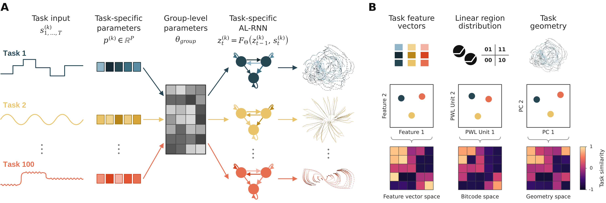

# Multitask interactions in recurrent dynamics across 100 cognitive tasks

Code for the paper *Multitask interactions in recurrent dynamics across 100 cognitive tasks*
(under review).

We train hierarchical Almost-Linear RNNs (AL-RNNs) jointly on a battery of 100 supervised
cognitive tasks to ask how tasks interact inside a shared recurrent backbone: when do they
transfer, when do they interfere, and how does that relate to task complexity and model
structure. The AL-RNN lets us dial nonlinear capacity independently of latent dimension,
while a low-dimensional per-task feature vector gives each task its own adaptation interface
on top of shared group-level parameters.



**A** — every task gets a low-dimensional feature vector `p(k)` that modulates shared
group-level parameters, producing a task-conditioned AL-RNN inside one recurrent backbone.
**B** — the trained model yields three complementary task representations: task feature
vectors, linear-region (bitcode) usage, and state-space geometry. Each defines a
task-similarity space.

## What is in this repository

```
mtl/            the library, organised by experimental arm
  shared/         scoring, battery selection, held-out split, thresholds
  hierarchical/   AL-RNN with per-task feature vectors + BPTT trainer
  flat/           one shared network, task identity as a one-hot input
  indiv/          one network per task, trained independently
  analysis/       bitcode distributions, trajectories (producers, not plots)
scripts/        thin CLIs -- argument parsing and nothing else
tasks/          the 100-task battery, one module per task
```

Every script is `build_parser()` + `main()`; the experiment itself lives in `mtl`. The three
training entry points are the 2×2 of {hierarchical, flat} × {joint, individual} minus the
impossible cell (a per-task feature vector needs more than one task).

## Install

```bash
conda env create -f environment.yml
conda activate multitask
pip install -e . --no-deps --no-build-isolation
```

Dependencies are owned by `environment.yml`; `pyproject.toml` only registers `mtl` and `tasks`
on the import path.

```bash
python -m tasks          # print the tagged battery table
```

## Reproducing the models

```bash
# hierarchical joint -- the main model (M=64, P=16 nonlinear units, N=16 task features)
python scripts/train_hierarchical_joint.py \
    --output-dir results/hier_joint \
    -M 64 -P 16 -N 16 \
    --sample-size 200 --val-size 50 --num-epochs 3000

# flat joint -- parameter-matched, task identity as a one-hot input
python scripts/train_flat_joint.py \
    --output-dir results/flat_joint -M 234 -P 16 --sample-size 200 --val-size 50

# individual -- one model per task, fans out over a job grid
python scripts/train_flat_indiv.py \
    --results-dir results/individual -P 16 --sample-sizes 200 --seeds 0 1 2 3 4
```

Adaptation and transfer:

```bash
# leave-one-out: fine-tune ONLY a new task-feature vector, shared weights frozen
python scripts/finetune/finetune_hierarchical_loo.py --loo-dir data/LeaveOneOutData84 --all

# task-to-task transfer between individually trained models
python scripts/finetune/finetune_flat_transfer.py \
    --source-checkpoint <model.pt> --target-task DelayPro --baseline-root <individual runs>
```

Scripts for the analyses that come after training, each reading a sweep of checkpoints:


```bash
python scripts/analysis/compute_bitcodes.py       # per-task linear-region distributions
python scripts/analysis/compute_trajectories.py   # latent trajectories for the geometry space
```

All runs write `model.pt`, `results.npz` and `metadata.json` to `--output-dir`; everything
derived goes under `data/`.